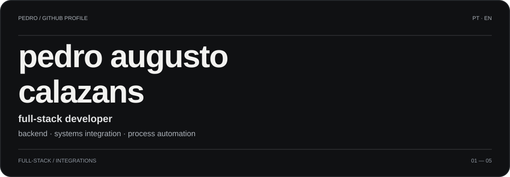

<picture><source media="(max-width: 600px)" srcset="assets/profile/hero-en-mobile-static.svg" /></picture>

[português](README.md) · [english](README.en.md) · [no motion](README.static.en.md)

---

### about

sixth-semester information systems student at CESAR School and a development/systems integration intern at HubVision. i primarily work in full-stack development, process automation, and ERP systems integration.

---

### experience

**hubvision** — automation and systems integration intern

- build automated workflows with **n8n** and **typebot**, including whatsapp customer service, payment slip delivery, and routing to human support queues
- build and maintain integrations through **rest apis** and **webhooks**, from payload design to error handling
- automate notifications, alerts, and billing communications
- query and manipulate relational database records, maintaining consistency across integrated systems
- create operational monitoring dashboards and business indicators

---

### personal projects

**[ad astra politics](https://ad-astra-politics.vercel.app/)** · next.js · vercel

an educational platform about brazilian politics. includes a quiz mapping users across 12 ideological axes, with uncertainty margins and explanations, an encyclopedia of the republic since 1889, and a government comparison tool using data series from ibge, ipea, brazil's central bank, and the world bank.

**[de marecos ao pajeú](https://pedroooojh.github.io/arvore-genealogica/)** · javascript · github pages

an interactive family tree tracing four centuries of my family history, from my maternal grandmother's roots in penafiel, portugal, to the backlands of pernambuco. includes individual profiles, migration maps, a historical timeline, sources, and research gaps.

**[ad astra downloader](https://github.com/pedroooojh/ad-astra-downloader)** · python · yt-dlp · ffmpeg

a windows desktop application to download youtube videos and audio, created for the ad astra community. configures yt-dlp on first launch, keeps it updated automatically, and is distributed as a pyinstaller executable.

---

### stack

| area | technologies |
|---|---|
| **backend and data** |     |
| **frontend** |      |
| **automation and integration** |     |
| **testing** |    |
| **deployment and tools** |     |
| **also used** |    |

