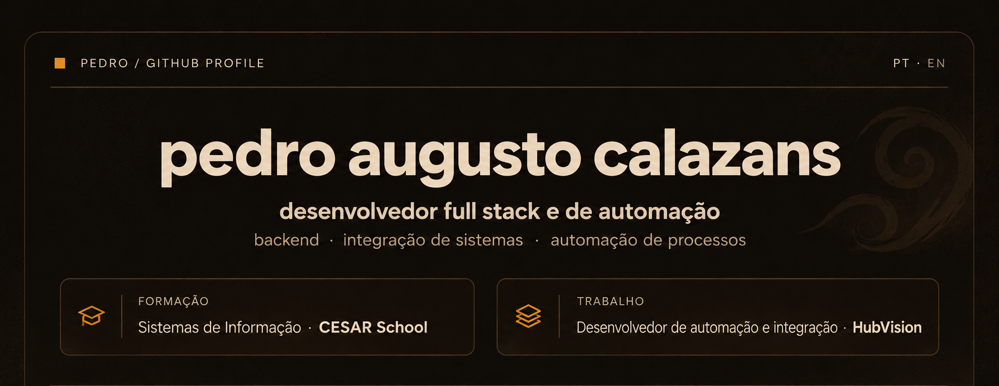
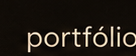
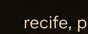

<picture><source media="(max-width: 600px)" srcset="assets/profile/hero-mobile-static.svg"/></picture>

<!-- Links reais, cada imagem tem um alvo independente. Não são hotspots dentro do SVG. -->
&nbsp;&nbsp;·&nbsp;&nbsp;&nbsp;&nbsp;·&nbsp;&nbsp;

<a href="README.md">português</a> · <a href="README.en.md">english</a> · <a href="README.static.md">sem animação</a>

---

### sobre

estudante do 6º período de sistemas de informação na CESAR School e estagiário de desenvolvimento/integração de sistemas na HubVision. atuo principalmente com desenvolvimento full-stack, além de trabalhar com automação de processos e integração de sistemas ERP.

---

### experiência

**hubvision** — estagiário de automação e integração de sistemas

- desenvolvo fluxos automatizados com **n8n** e **typebot**, incluindo atendimento via whatsapp com envio de boletos e roteamento para filas de atendentes
- construo e mantenho integrações entre sistemas via **apis rest** e **webhooks**, do desenho do payload ao tratamento de falhas
- automatizo a comunicação de notificações, alertas e cobrança
- consulto e manipulo dados em banco relacional, garantindo consistência entre os sistemas integrados
- crio dashboards de monitoramento operacional e indicadores de negócio

---

### projetos pessoais

**[ad astra politics](https://ad-astra-politics.vercel.app/)** &nbsp;  

plataforma educativa sobre política brasileira. reúne um quiz que posiciona o usuário em 12 eixos ideológicos, com margem de incerteza e explicação de cada resposta, além de uma enciclopédia da república desde 1889 e um comparador de governos com séries do ibge, ipea, banco central e banco mundial.

**[de marecos ao pajeú](https://pedroooojh.github.io/arvore-genealogica/)** &nbsp;  

árvore genealógica interativa que acompanha quatro séculos da minha linhagem familiar, a partir da minha avó materna, de penafiel, em portugal, ao sertão de pernambuco. tem fichas por pessoa, mapa de deslocamentos, cronologia histórica e registro das fontes e lacunas da pesquisa.

**[ad astra downloader](https://github.com/pedroooojh/ad-astra-downloader)** &nbsp;   

app desktop para windows que baixa vídeo e áudio do youtube, feito para a comunidade ad astra. configura o yt-dlp na primeira execução, mantém ele atualizado sozinho e é distribuído como executável via pyinstaller.

---

### stack

| área | tecnologias |
|---|---|
| **backend e dados** |     |
| **frontend** |      |
| **automação e integração** |     |
| **testes** |    |
| **deploy e ferramentas** |     |
| **também já usei** |    |

